<div align="center">

# RT — Multi-Threaded & Dual-GPU Ray Tracer in C

**42 School Advanced Graphical Project · Physically-Inspired Ray Tracing Engine**

[](Makefile)
[](.cursor/rules/norminette.mdc)
[](cleanup.c)
[](Parallel/threads.c)
[](gpu/kernels/trace.cl)

<br />

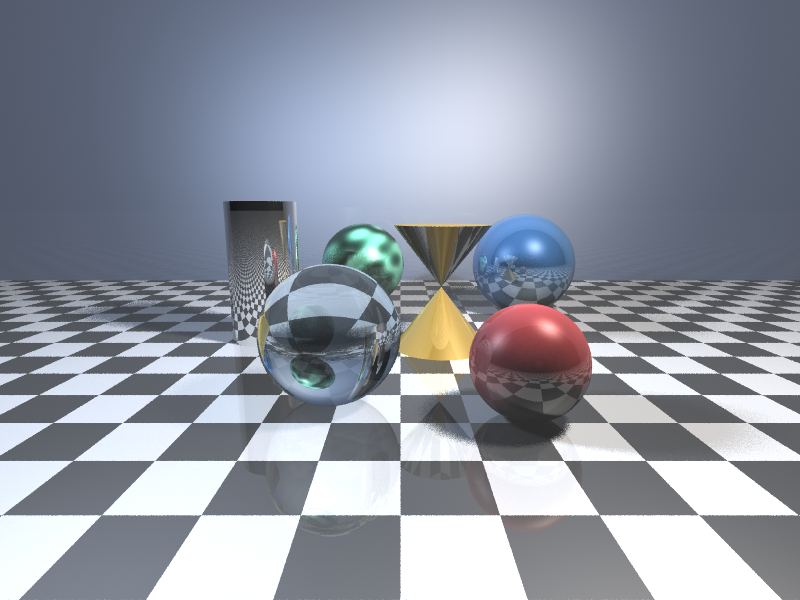

*Live render produced by `./rt` — Snell refraction, 5-bounce chrome reflection, procedural checker & marble, soft area shadows, and progressive anti-aliasing.*

</div>

---

## Highlights

Built from scratch in **42-Norminette-clean C** (evolved from [mini-RT](https://github.com/pix3l-p33p3r/mini-RT)) with **full CPU + Dual-GPU OpenCL parity**, **zero memory leaks**, and **19 ready-to-render `.rt` scenes**:

- **Mandatory Primitives (Analytic Equations):** Plane (`pl`), Sphere (`sp`), Cylinder (`cy`), Cone (`cn`) with translation/rotation transforms & zero-recompute MLX Expose redraw.
- **Extra & Composed Shapes:** Möller–Trumbore Triangles (`tr`), Limited Half-Spheres (`hs`), Limited Disks (`dk`), Native Quadric Paraboloids (`pb`), Sphere-Traced Torus (`to`), and **Negative CSG Subtraction (`ns`)**.
- **Optics & Lighting:** Multi-spot RGB point lights (`L`), **Soft Area Shadows** (jittered spherical light radius), **Parallel Directional Sun (`D`)**, 5-bounce **Recursive Mirror Reflection**, **Snell's Law Refraction + Total Internal Reflection**, **Tinted Transparent Shadows**, and **RGB Chromatic Dispersion** on high-IOR crystal glass.
- **Surfaces & Textures:** Procedural **Checker**, **Stripe**, and **Marble** color disruption, tangent-frame **Bump Mapping**, and built-in **PPM (P6/P3) Image Texture** mapping (`assets/earth_grid.ppm`).
- **Stereoscopic 3D & VR:** Live `V` key toggle between **Mono**, **Red-Cyan Anaglyph 3D**, and **Side-by-Side VR Headset** rendering.
- **Performance:** Lock-free zero-malloc 4×4 transforms across **POSIX pthreads (`nproc` threads)** + **Multi-GPU OpenCL 1.2** compute splitting scanlines proportionally by Compute Units (tested live on **AMD Radeon RX 6500 (16 CU) + Intel UHD Graphics 770 (2 CU)** simultaneously).
- **Live Defence Manipulation:** Real-time `WASD`/`QE` camera fly-through, arrow look, live `G` GPU↔CPU switch, and instant `P` PPM frame export.

---

## Render Gallery

*Every image below is rendered directly by `./rt` / `./rt-gpu` — zero external rendering tools.*

### Showcase Art & Chromatic Dispersion

| 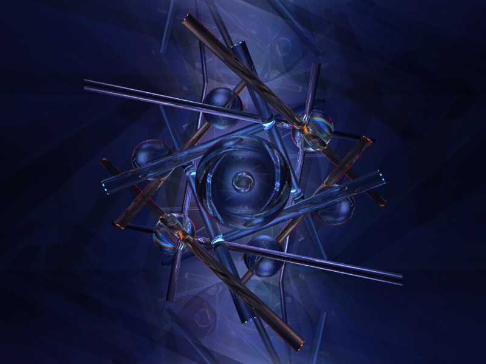 |  |
| :---: | :---: |
| **Prism Vortex** (`scenes/prism_vortex.rt`) — high-IOR RGB dispersion | **Liquid Glass Snowflake** (`scenes/liquid_snowflake.rt`) — 69 crystal elements |

| 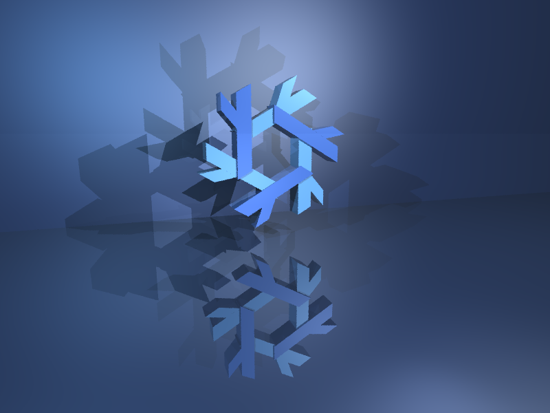 | 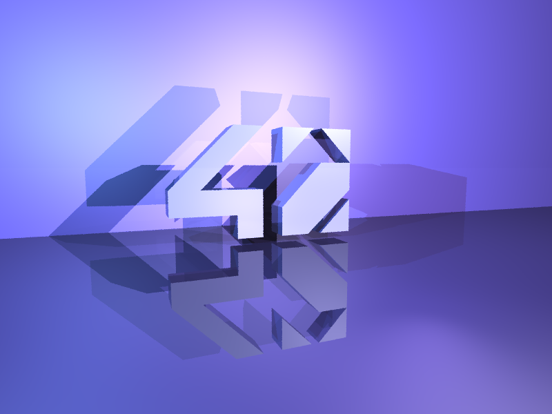 |
| :---: | :---: |
| **3D Extruded NixOS Logo** (`scenes/nixos_logo.rt`) — 144 triangles | **3D Extruded 42 Logo** (`scenes/logo_42.rt`) — metallic studio 3/4 view |

### Optics — Reflection, Refraction & Transparent Shadows

| 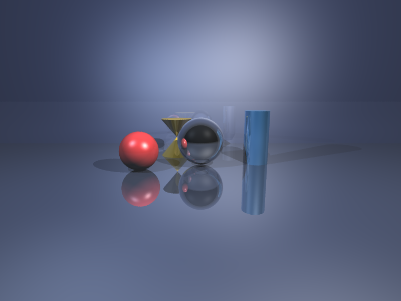 | 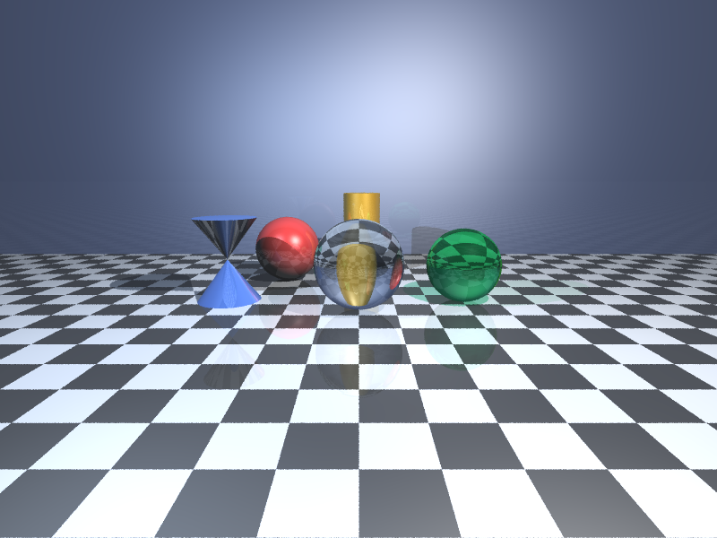 |
| :---: | :---: |
| **5-Bounce Mirror Reflection** (`scenes/mirror_demo.rt`) | **Snell Refraction & Emerald Shadows** (`scenes/glass_demo.rt`) |

### Surfaces, Extra Shapes & Negative CSG

| 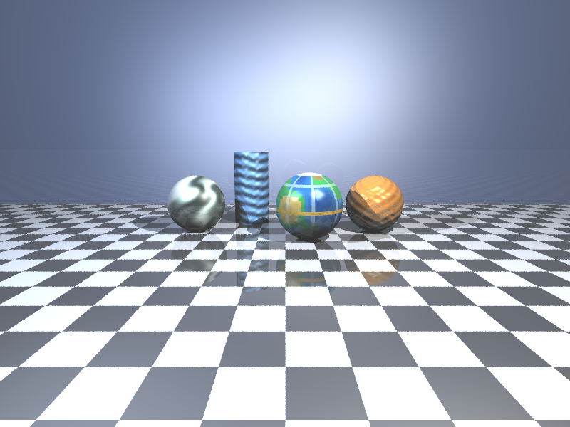 | 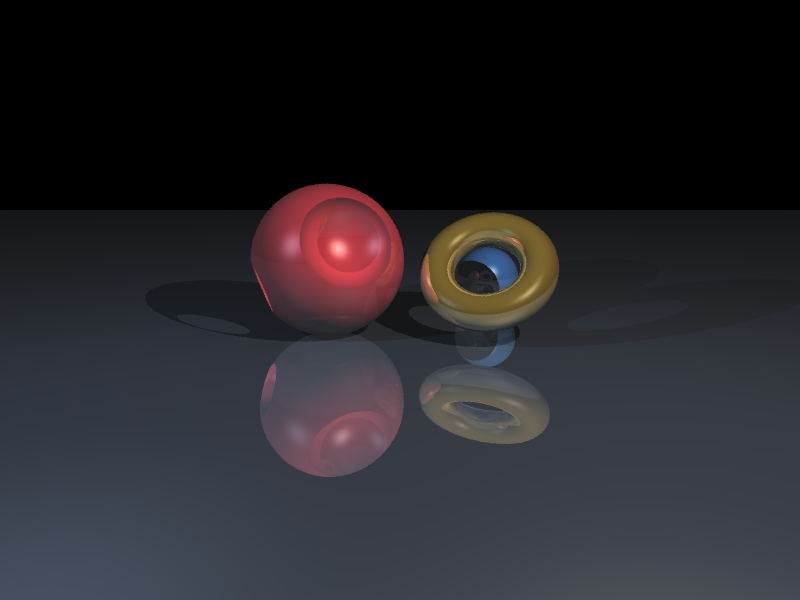 |
| :---: | :---: |
| **Checker, Marble, Bump & PPM Globe** (`scenes/surfaces_demo.rt`) | **Torus (`to`) + Negative CSG (`ns`)** (`scenes/csg_torus_demo.rt`) |

| 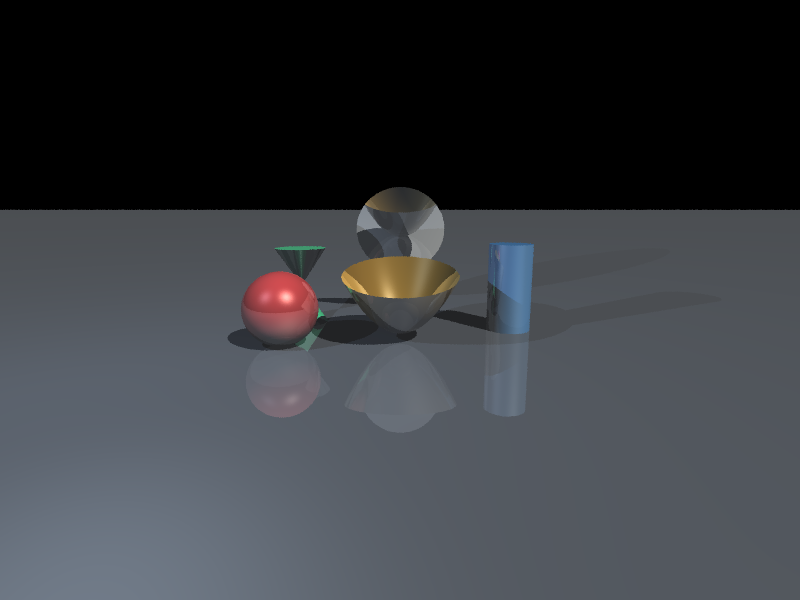 | 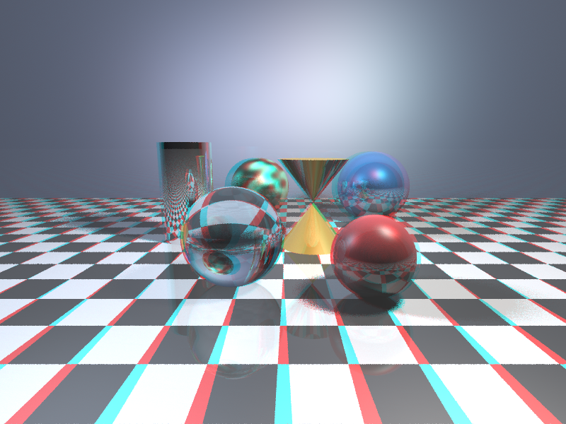 |
| :---: | :---: |
| **Paraboloid (`pb`), Mirror Disk (`dk`) & Sun (`D`)** (`scenes/shapes_demo.rt`) | **Red-Cyan Anaglyph 3D + Soft Shadows** (`RT_STEREO=1 scenes/stereo_soft_demo.rt`) |

### Recreated mini-RT Classics & Subject Scenes (VI.1 – VI.3)

| 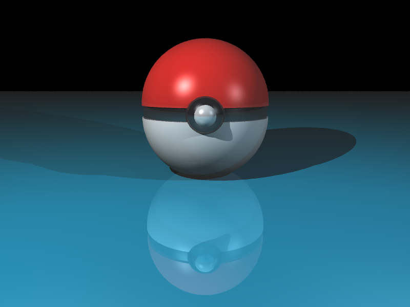 | 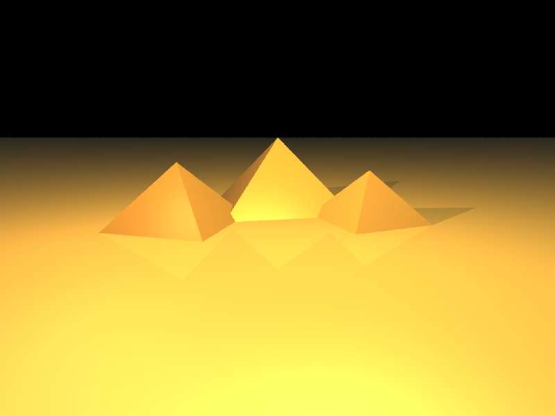 | 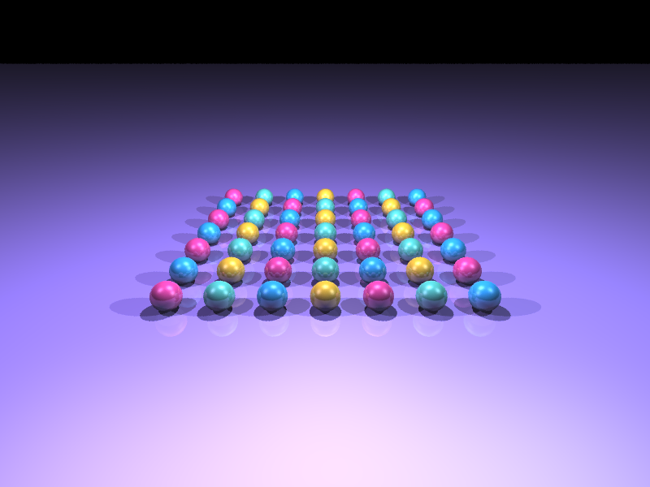 |
| :---: | :---: | :---: |
| **Pokéball** (`scenes/pokeball.rt`) | **Giza Pyramids** (`scenes/giza.rt`) | **7×7 Multi-Spots** (`scenes/multi_spots_grid.rt`) |

| 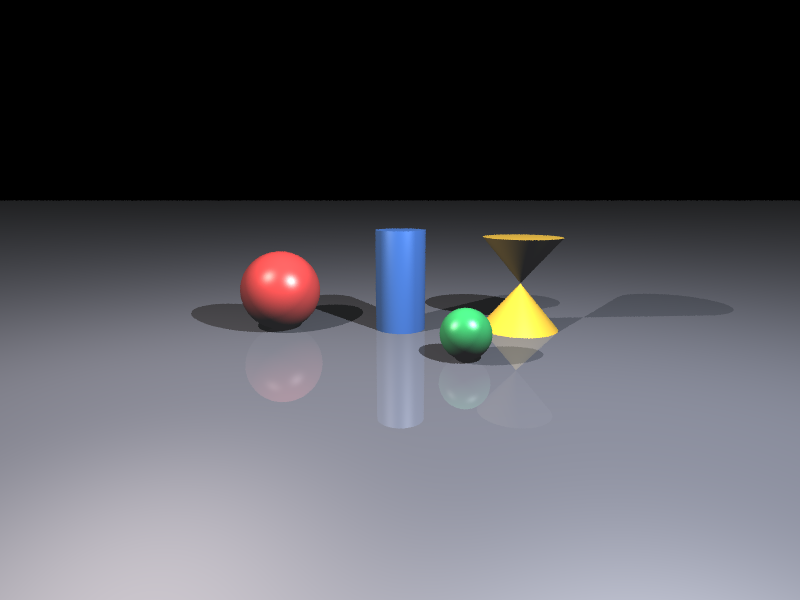 | 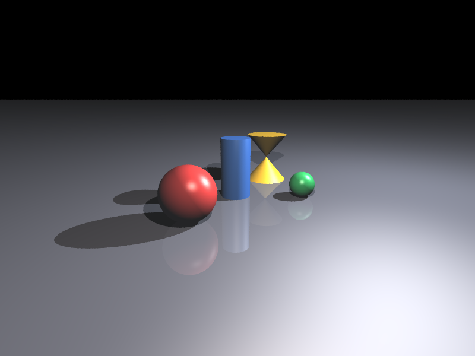 | 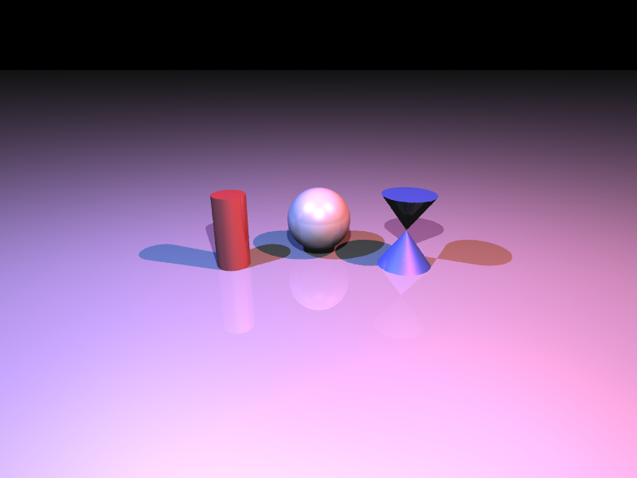 |
| :---: | :---: | :---: |
| **Fig VI.1** — 4 Basic Shapes | **Fig VI.2** — Alternate Viewpoint | **Fig VI.3** — RGB Shadow Mixing |

---

## Quick Start

### 1. Build & Run (CPU Multi-Threaded — Default)

Requires MiniLibX (`-lmlx -lXext -lX11`), `-lm`, `-pthread`, and `-lOpenCL` (OpenCL headers are vendored in `third_party/OpenCL/`).

```bash
git clone git@github.com:pix3l-p33p3r/RT.git
cd RT
make
./rt scenes/stereo_soft_demo.rt
```

Optional environment variables:
- `RT_THREADS=N` — override CPU worker thread count (defaults to all online cores, up to 64)
- `RT_STEREO=1` / `RT_STEREO=2` — start directly in **Anaglyph 3D** or **Side-by-Side VR**
- `RT_MAX_FRAMES=N` — stop after `N` progressive AA frames and exit cleanly (`0` leaks)
- `RT_EXPORT_PATH=out.ppm` — automatically save final frame to PPM on completion

### 2. Run on Dual-GPU OpenCL (AMD RX 6500 + Intel UHD 770)

A reproducible Nix flake (`flake.nix`) bundles `ocl-icd`, `opencl-headers`, `intel-compute-runtime`, and `mesa.opencl` (pinned to `nixos-24.05` for Linux 5.15 cluster kernels). Launch in one command:

```bash
./rt-gpu scenes/liquid_snowflake.rt
```

Startup output:
```text
[rt] OpenCL multi-GPU ready (2 device(s)):
  - GPU #0: Mesa Intel(R) UHD Graphics 770 (ADL-S GT1) (2 CU) -> rows [0..66)
  - GPU #1: AMD Radeon RX 6500 (radeonsi, navi24, ...) (16 CU) -> rows [66..600)
```

*(Builds a separate `rt_ocl` binary inside the Nix OpenCL environment so native `./rt` is never overwritten.)*

---

## Live Interactive Controls

| Key | Action |
| :---: | :--- |
| `W` `A` `S` `D` | Move camera forward / left / back / right |
| `Q` / `E` | Move camera up / down |
| `←` `→` `↑` `↓` | Yaw & pitch camera view direction |
| `V` | Cycle **Mono → Red-Cyan Anaglyph 3D → Side-by-Side VR** |
| `G` | Live toggle **Dual-GPU OpenCL ↔ CPU Pthreads** |
| `P` | Export current frame to `render_out.ppm` |
| `ESC` / `X` | Clean shutdown (frees all MLX, GPU, texture & matrix memory) |

---

## Scene File Format (`.rt`)

All objects remain backwards-compatible with standard `.rt` scenes and accept optional trailing material tokens:

```text
[mirror [transp [ior [pattern [bump [ppm_path]]]]]]
```
- `mirror` (`0.0–1.0`): recursive reflection weight
- `transp` (`0.0–1.0`): refractive glass transparency
- `ior` (`1.0–3.0`): refractive index (`>= 1.7` activates RGB chromatic dispersion)
- `pattern`: `0` solid · `1` checker · `2` stripe · `3` marble · `4` PPM image texture
- `bump` (`0.0–2.0`): tangent-space normal wave amplitude

| Token | Syntax | Description |
| :---: | :--- | :--- |
| `A` | `A ratio R,G,B` | Ambient light |
| `C` | `C ox,oy,oz lx,ly,lz fov` | Camera position, look-at (`[-1,1]`), horizontal FOV |
| `L` | `L x,y,z intensity R,G,B [radius]` | Point / soft area light (`radius > 0` for soft shadows) |
| `D` | `D dx,dy,dz intensity R,G,B` | Parallel / directional sun light |
| `sp` | `sp cx,cy,cz diam R,G,B [mat...]` | Sphere |
| `pl` | `pl px,py,pz nx,ny,nz R,G,B [mat...]` | Infinite plane |
| `cy` | `cy cx,cy,cz ax,ay,az diam height R,G,B [mat...]` | Capped cylinder |
| `cn` | `cn cx,cy,cz ax,ay,az diam height R,G,B [mat...]` | Capped cone |
| `tr` | `tr x1,y1,z1 x2,y2,z2 x3,y3,z3 R,G,B [mat...]` | Triangle (Möller–Trumbore) |
| `hs` | `hs cx,cy,cz nx,ny,nz diam R,G,B [mat...]` | Clipped half-sphere |
| `dk` | `dk cx,cy,cz nx,ny,nz diam R,G,B [mat...]` | Limited circular disk |
| `pb` | `pb cx,cy,cz ax,ay,az diam height R,G,B [mat...]` | Quadric paraboloid |
| `to` | `to cx,cy,cz nx,ny,nz major_r minor_r R,G,B [mat...]` | Native torus (SDF sphere-traced) |
| `ns` | `ns cx,cy,cz diam` | Negative CSG sphere (carves solid objects) |

---

## Verification & Quality Gates

Run the complete verification suite (Norminette + 7 math unit tests + all 19 `.rt` scenes):

```bash
./scripts/verify_all_scenes.sh
```

```bash
# Valgrind memory-leak audit (0 bytes in 0 blocks, 0 errors):
RT_MAX_FRAMES=1 RT_THREADS=4 valgrind --leak-check=full ./rt scenes/surfaces_demo.rt
```

See [DEFENCE.md](./DEFENCE.md) for the live peer-evaluation checklist and [TODO.md](./TODO.md) for the full feature roadmap.

---

## Branches & Team

| Branch | Role |
| :--- | :--- |
| `main` | Stable / defence-ready |
| `develop` | Active integration |
| `test` | Pre-promotion test mirror |

Flow: `develop → test → main` (always synced with GitHub).

<div align="center">

Built by [@pix3l-p33p3r](https://github.com/pix3l-p33p3r) & [@0xakhii](https://github.com/0xakhii) · **1337 / 42 Network**

</div>
